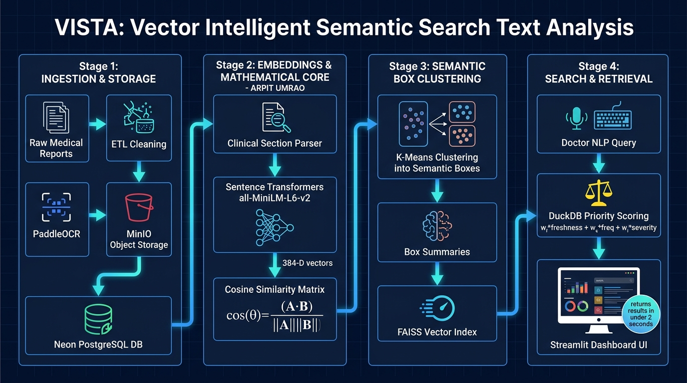

<p align="center">
  
</p>

<h1 align="center">VISTA: Vector Intelligent Semantic Search Text Analysis</h1>

<p align="center">
  A semantic healthcare data warehouse platform that organizes and retrieves medical reports based on <b>meaning</b>, not just keywords — powered by box-clustering, transformer embeddings, cosine similarity, and priority-based ranking.
</p>

<p align="center">
  
  
  
</p>

<p align="center">
  <a href="info/DOCUMENTATION.md">
    
  </a>
</p>

---

## 📊 Project Statistics & Targets

<p align="center">

| 📄 Medical Reports | 🏥 Medical Departments | 🧠 Embedding Size | ⚡ Average Search | 🎯 Semantic Accuracy Target |
|:---:|:---:|:---:|:---:|:---:|
| **5,000+** | **40+** | **384-D** | **< 2 sec** | **95%** |

</p>

---

## 📌 Problem Statement

Hospitals generate millions of medical reports every year — discharge summaries, lab results, radiology notes, prescriptions, and clinical observations. Traditional hospital storage relies on fragmented folder structures and rigid keyword-based search, making it difficult to retrieve semantically related reports when terminology differs across departments (e.g. *"heart attack"* vs. *"myocardial infarction"*).

**The traditional hospital search bottleneck:**

```
Doctor ──> [ Keyword Query ] ──> Fails on synonyms, takes several minutes
             ├── Fragmented PDFs & Bills
             ├── Multi-departmental Notes
             └── Disconnected Legacy Storage
```

This leads to:
- 🔁 Duplicated documentation and fragmented patient files
- ⏱️ Delayed diagnosis and slower historical case reviews
- 📉 Inefficient clinical search causing operational drag
- 📈 Compounding administrative burden as clinical data lakes expand

Additionally, embedding **every single document** individually is computationally expensive at scale — VISTA's core research question is whether **grouping documents into semantic "boxes" first** can match the retrieval quality of full per-document embedding search, at a fraction of the compute cost.

---

## 💡 Proposed Solution

**VISTA** eliminates keyword barriers by understanding the underlying clinical meaning behind medical text — and instead of embedding every raw file, it clusters documents into semantic **boxes** (e.g. "blood reports," "radiology notes") and embeds only a short summary per box. A query first matches to the closest box, then a **priority score** (freshness + call frequency + importance) pinpoints the exact file within it.

**The VISTA accelerated workflow:**

```
Doctor ──> Natural Language Query ──> Query Embedding ──> FAISS Box Match ──> Priority-Ranked File (< 2s)
```

- **Context-aware** — recognizes clinical synonyms instantly
- **Self-organizing** — automatically clusters medical reports by underlying pathology into labeled boxes
- **Compute-efficient** — searches across box summary embeddings, not every individual document
- **Priority-aware** — surfaces the most relevant file within a box using freshness, access frequency, and importance

---

## 🏗️ System Architecture & Workflow

<p align="center">
  
</p>

**The end-to-end pipeline:**

1. **Raw Medical Reports** (PDFs, images, text) enter the system
2. **ETL Pipeline** — cleans files, deduplicates, removes errors
3. **OCR Processing** — PaddleOCR extracts text from image-based/scanned reports
4. **Storage** — raw files → **MinIO**; structured metadata → **Neon (PostgreSQL)** warehouse, linked by a stable `document_id`
5. **Metadata Analytics** — DuckDB analyzes freshness and call-frequency signals
6. **Document Embeddings** — Sentence Transformer (`all-MiniLM-L6-v2`) vectorizes cleaned text
7. **Cosine Similarity Computation** — pairwise document similarity, normalized and verified
8. **K-Means Clustering** — groups documents into semantic "boxes"
9. **Box Summary Generation + Embedding** — a short summary is generated per box and embedded
10. **FAISS Index** — indexes box summary embeddings only, not every document
11. **Priority Scoring Layer** — `priority_score = freshness + call_frequency + importance`
12. **User NLP Query** → embedded → matched to nearest box via FAISS → **File Selection Within Matched Box** using the priority score → **Ranked Result Returned to User**

---

## 🧮 How Cosine Similarity Works

Instead of raw coordinate distance — which biases toward document length — cosine similarity calculates the geometric angle (θ) between two high-dimensional text vectors:

$$\cos(\theta) = \frac{A \cdot B}{\Vert A \Vert \Vert B \Vert}$$

| Score Range | Meaning |
|:---:|---|
| **1.0** | Near-identical clinical meaning |
| **0.8+** | Highly related medical context |
| **0.5** | Moderately related context |
| **0.0** | Completely unrelated records |
| **-1.0** | Semantically opposite concepts |

---

## 🛠️ Phase-1 ETL, OCR & Storage Pipeline

### 1. Storage Layout in MinIO (`vista-lake`)
```bash
bash manage_vista.sh up          # start MinIO + create vista-lake bucket
```

Layered layout in `s3://vista-lake/`:
- `raw/` — original phase-one files, uploaded unchanged (18,826 objects)
- `clean/` — the full RESULT corpus: 10 clean parquets, `ocr_text/*.txt`, `_manifest.json`
- `summaries/` — per-source profiles + `phase1_summary.md` + `phase1_clean_summary.md`
- `reports/` — pipeline run reports

### 2. Running Phase-1 Ingestion & OCR
```bash
# 1. ETL: raw -> clean -> summaries -> MinIO
python project/code/run_phase1.py

# 2. PaddleOCR over the report PDFs (resumable; cached in RESULT/clean_data/ocr_text/)
cd project/code && python -m ocr_reports

# 3. Assemble the RESULT folder for phase 2
python project/code/build_result.py

# 4. Sync the finished RESULT corpus back into the MinIO clean layer
python project/code/sync_result_to_minio.py
```

### 3. RESULT Folder (Input for Embeddings & Clustering)
`RESULT/clean_data/` contains every cleaned source produced by the pipeline:
- `*.parquet` — one typed, deduplicated dataset per source
- `ocr_text/*.txt` — full PaddleOCR text per parsed report PDF/DOCX
- `_manifest.json` — per-source cleaning + OCR statistics
- `phase1_clean_summary.md` — human-readable roll-up

### 4. OCR Engine Details
`project/code/vista_ocr` uses **PaddleOCR (PP-OCRv5/v6 models)** for images and scanned PDFs; digital PDFs use the embedded text layer via PyMuPDF.

---

## ⚡ Embeddings, Clustering & Search Pipeline

### 1. Embeddings & Cosine Similarity Math (Phases 2–3)
```bash
# Vectorize reports into 384-D dense vectors and compute similarity matrix:
python Backend/Embeddings/pipeline.py --sample-size 1000
```

### 2. K-Means Box Clustering + FAISS Box Index (Phase 4)
```bash
# Consumes the Phase 2/3 cache; selects K via silhouette sweep (--auto-k)
# and exports the full box layer to data/clustering/:
python Backend/Clustering/pipeline.py --auto-k
```

> Measured on 1,000 real MTSamples reports: **12 semantic boxes, specialty purity 95.5%**, box-level FAISS index of just 12 vectors instead of 1,000 document vectors.

### 3. End-to-End Semantic Retrieval
```python
from Backend.Clustering.retrieval_engine import VISTARetrievalEngine

engine = VISTARetrievalEngine.from_default_paths()
result = engine.search("elevated troponin, acute myocardial infarction", top_boxes=2)
```

### 4. Verify Output Correctness
```bash
python tests/verify_output.py            # Phases 2-3 bundle audit
python tests/test_phase4_clustering.py   # Phase 4 clustering audit
```

### 5. NLP Dashboard (Streamlit)
```bash
streamlit run Frontend/Streamlit/app.py
```

The Next.js workspace in `Frontend/Next/` opens with a role chooser. The Technician workspace includes ingestion, OCR/ETL, clinical fingerprinting, 384-D embeddings, semantic box assignment, storage, analytics, and document tools. The Doctor workspace provides patient and condition search, a report collection, and report previews. Start FastAPI with `python -m uvicorn Backend.api:app --reload --port 8000`, set `NEXT_PUBLIC_API_URL=http://127.0.0.1:8000` in `Frontend/Next/.env.local`, and run `npm.cmd run dev` from `Frontend/Next`.

Dashboard routes:
- **Role chooser** ? `/`
- **Technician workspace** ? `/technician`
- **Doctor workspace and reports** ? `/doctor` and `/doctor/reports`
- **🔍 Semantic Search** — natural-language query → FAISS box match → priority-ranked documents with latency vs. the < 2s target
- **📦 Box Explorer** — 2-D PCA map of the corpus colored by semantic box, per-box labels/keywords/members
- **📊 Cluster Analytics** — silhouette / Davies-Bouldin / Calinski-Harabasz / specialty purity, K-sweep chart, box↔specialty sunburst, similarity heatmap
- **📁 Document Browser** — full corpus table with box/specialty filters and text previews

---

## 📂 Repository Structure

```text
VISTA
├── Backend/
│   ├── Embeddings/           # Sentence Transformer + cosine similarity math
│   ├── Clustering/           # Phase 4: K-Means boxes, box summaries, FAISS index, retrieval engine
│   ├── ETL/                  # Cleaning, deduplication, error removal
│   └── OCR/                  # Document parsing and extraction
├── project/code/
│   ├── vista_ocr/            # Integrated PaddleOCR extraction engine
│   ├── vista_pipeline/       # Layered ETL pipeline (ASTRA-style, MinIO-backed)
│   ├── run_phase1.py         # Phase-1 ETL orchestrator (ingest -> clean -> summarize)
│   ├── ocr_reports.py        # Resumable PaddleOCR runner for report PDFs
│   └── build_result.py       # Assembles RESULT/clean_data/
├── Database/
│   ├── MinIO/                # Raw file object storage
│   ├── Neon/                 # Structured metadata warehouse
│   └── DuckDB/               # Metadata analytics + priority scoring
├── Frontend/
│   └── Streamlit/            # NLP dashboard: semantic search, box explorer, cluster analytics
├── data/
│   ├── processed/            # Phase 2/3 handoff bundle (embeddings, similarity, graph)
│   └── clustering/           # Phase 4 artifacts (box index, labels, metrics, projection)
├── info/
│   ├── architecture.png      # System architecture diagram
│   └── DOCUMENTATION.md      # Comprehensive technical documentation
├── docs/                     # Academic synopses, presentation slide decks, and reports
├── RESULT/clean_data/        # Clean corpus for embedding and vector search
└── tests/                    # Unit and integration test suites
```

---

## 🎯 Accuracy Targets & Evaluation Benchmarks

1. **Semantic Retrieval Accuracy Target: `95%`** (Top-3 Retrieval Accuracy).
2. **Specialty Separability Ratio Target: `> 2.0x` (Achieved: `4.63x`)**.
3. **Retrieval Latency Target: `< 2.0 seconds`**.

---

## 📄 License

This project is licensed under the MIT License — see the [LICENSE](LICENSE) file for details.
